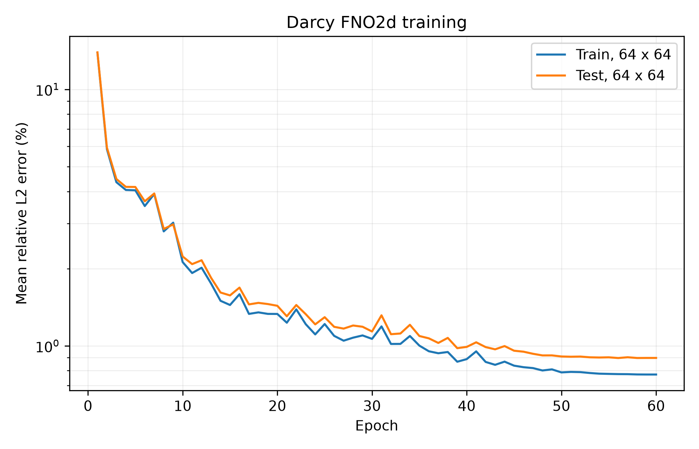
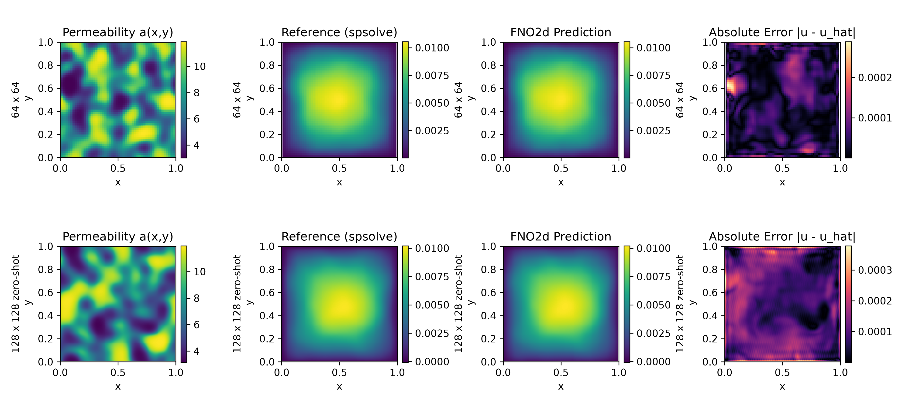

# fourier-neural-operator-pde

A PyTorch implementation of a Fourier neural operator for 2D Darcy flow.
It learns the solution from permeability and coordinates at 64x64, then uses
the same weights at 128x128 without fine-tuning.

## Problem and data

$$
-\nabla\cdot(a(x,y)\nabla u)=1 \quad \text{in }(0,1)^2,
\qquad u=0 \quad \text{on }\partial\Omega,
\qquad \mathcal G:(a,x,y)\mapsto u.
$$

The reference solver uses $N\times N$ interior vertices, spacing $h=1/(N+1)$,
and row-major indexing $jN+i$. Its five-point stencil uses harmonic means on
interior faces and the local conductivity at outer Dirichlet faces.
The matrix is assembled in CSC format and solved with `scipy.sparse.linalg.spsolve`
in float64; datasets are stored in float32.

Physical wavevectors are computed as
`k = 2 * np.pi * np.fft.fftfreq(N, d=h)`.
$\exp[-(k_x^2+k_y^2)/(2(6\pi)^2)]$. Each field is standardized, then mapped to
$a=3+9/(1+\exp(-1.5g))\in(3,12)$. The physical bandwidth stays fixed; the
finite-grid FFT period $N/(N+1)$ differs slightly between resolutions.

| Split | Samples | Grid | Dataset seed |
| --- | ---: | --- | ---: |
| Train | 800 | 64x64 | 42 |
| Test | 100 | 64x64 | 100 |
| Zero-shot test | 100 | 128x128 | 200 |

The test sets are independent realizations, not paired grids. Normalization
uses training data only: standardize permeability, map coordinates to $[-1,1]$,
and divide targets by the training solution RMS. Predictions are rescaled
before evaluation.

## Model

Each block adds a spectral convolution to a local $1\times1$ convolution.
`SpectralConv2d` uses orthonormal `rfft2`/`irfft2` transforms and complex channel
mixing on vertical slices `:12` and `-12:` and horizontal bins `:12`.
Unretained Fourier coefficients are zero.

```text
(B, 3, H, W)
 -> Conv1x1: 3 -> 32
 -> 3 x [SpectralConv2d + Conv1x1 -> GELU]
 ->      SpectralConv2d + Conv1x1
 -> Conv1x1: 32 -> 128 -> GELU -> Conv1x1: 128 -> 1
 -> (B, 1, H, W)
```

There are **1,188,353 trainable tensor elements**, counting each complex
element once, or **2,368,001 real-valued parameter components**.
The loss is the mean per-sample relative error,
$\frac1M\sum_s\|\hat u_s-u_s\|_2/\|u_s\|_2$.

Training uses Adam (learning rate $10^{-3}$, weight decay $10^{-4}$),
60 epochs, batch size 32, and cosine learning-rate decay. Initialization and
shuffling use seed 42. The 64x64 test error is monitored each epoch; the reported
weights are from epoch 60, not selected by the minimum test error.

The architecture follows [Li et al., Fourier Neural Operator for Parametric
Partial Differential Equations](https://arxiv.org/abs/2010.08895).

## Run

From the repository root, in a Python environment with the required PyTorch build:

```bash
pip install -r requirements.txt
python3 src/train.py
```

This runs training, both evaluations, timing, and plot generation. A short
execution check is:

```bash
python3 src/train.py --epochs 2 --n-train 32 --n-test 16 --batch-size 16
```

The short run does not enforce the 5% accuracy checks or replace the saved plots.
Those apply when `--n-train >= 800`. Datasets, weights, and measurements are cached
under ignored `data/`; no pretrained checkpoint is included in Git.
Repeating a full run overwrites the figures in docs/.


The public files are:

    .gitignore
    requirements.txt
    README.md
    src/data.py
    src/model.py
    src/train.py
    docs/training_curve.png
    docs/prediction_superres.png

Caches and weights remain in the ignored root data/ directory, independent of
the working directory.

## Measured results

GPU: **NVIDIA GeForce RTX 5060 Laptop GPU**. CPU: **AMD Ryzen 9 8940HX with Radeon Graphics**, one PyTorch CPU thread.
Recorded environment: Python 3.12.3, PyTorch 2.15.0+cu132, NumPy 2.5.4,
SciPy 1.18.1, and Matplotlib 3.11.2. The dependency file is not
version-locked; numerical and timing results can vary with hardware and software.

| Evaluation | Mean relative L2 error |
| --- | ---: |
| 64x64 test | 0.897% |
| 128x128 zero-shot test | 1.78% |

Both means are below 5%. The final training error is 0.773%.
Training with epoch-end evaluations took 50.7 s.



Mean train and 64x64 test errors after each epoch, on a logarithmic vertical axis.

### Single-sample latency

| Grid | FNO on GPU (ms) | spsolve on CPU (ms) | Ratio |
| --- | ---: | ---: | ---: |
| 64x64 | 4.80 | 10.0 | 2.09x |
| 128x128 | 4.43 | 71.5 | 16.1x |

Each mean uses 50 calls after five warm-ups on test sample 0, with batch size one.
CUDA is synchronized around each timed call. FNO timing includes normalization,
forward inference, and output rescaling, with inputs already on the GPU;
host/device transfers are excluded. Sparse timing includes matrix assembly,
factorization, and solution on the CPU. Dataset loading is excluded from both.

This is a GPU-versus-CPU latency comparison on a repeated coefficient, not an
equal-hardware or end-to-end speed comparison. The ratio is mean sparse time
divided by mean FNO time.



Test sample 0 at 64x64 (top) and an independent unseen sample at 128x128 (bottom).
Columns show permeability, reference, prediction, and absolute error.
Reference and prediction use the same color range within each row.
Both figures in docs/ are saved at 300 DPI.

These results cover one training seed, one coefficient distribution, and two
resolutions. They do not establish performance on other forcing or boundary
conditions, and the network does not impose zero boundary values exactly.
